<div align="center">

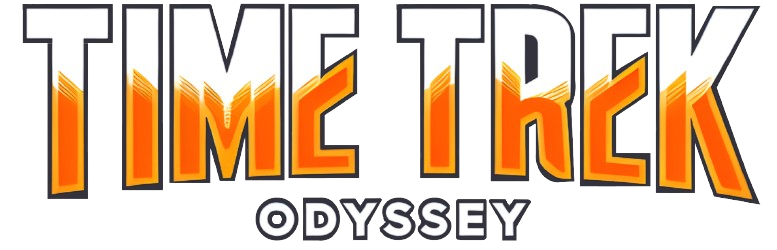

### Un juego de plataformas 2D para aprender historia viajando en el tiempo


[Página web](https://timetrekodyssey.netlify.app) ·
[Investigación (PDF)](https://uninorte-my.sharepoint.com/:b:/g/personal/keslyr_uninorte_edu_co/IQCfni1PV1D9QpK_0MRGfyjUAfmK1oBCkdLuWhzcCOTeF1Q?e=fFW3Su)

</div>

---

## Descripción

**Time Trek: Odyssey** es un videojuego de plataformas 2D desarrollado en **Java** como proyecto de **Estructuras de Datos 1**. El jugador controla a Alexander Thorne, un científico que queda atrapado en el pasado después de que su máquina del tiempo se destruye y sus piezas se dispersan a través de cinco eras de la historia.

El objetivo es recorrer cada era ilustrada en los 5 niveles, derrotar a sus enemigos, recolectar los objetos históricos necesarios y recuperar la pieza perdida de la máquina del tiempo. Cada objeto que se recoge va acompañado de una narración que explica su importancia histórica, dando un aporte educativo.

**Misión del jugador:**

1. **Completar los cinco niveles** enfrentando a los enemigos propios de cada época.
2. **Recolectar los objetos históricos** de cada era (son necesarios para avanzar al siguiente nivel).
3. **Recuperar la pieza de la máquina del tiempo** para que el científico pueda volver a su presente.

---

## La historia: *The Fragments of Time*

> In a hidden laboratory beneath the city's shadows, scientist **Alexander Thorne** worked tirelessly on his time machine. His disheveled hair and tired eyes reflected years of dedication and obsession. The machine was nearly ready, and Alexander could feel the electricity in the air as he adjusted the final gears.
>
> However, just as Alexander was about to activate the machine, lightning struck the building. The explosion shook the walls, and the time machine crumbled into a whirlwind of sparks and smoke. When the mist cleared, Alexander found himself in a strange place, surrounded by debris and confusion.
>
> He realized he had traveled to the past, but not the past he had planned. The pieces of his time machine had scattered across five distinct eras: **the Jurassic Period, Prehistory, Antiquity, the Middle Ages, and the Contemporary Age**. Alexander had no choice but to embark on an epic quest to retrieve the lost fragments.
>
> Alexander donned his leather coat and adjusted his glasses on his nose. Each era held its dangers and mysteries, but he was determined to recover the pieces and fix his time machine. Thus began his odyssey through the centuries, chasing the shards of time and facing challenges only a temporal traveler could comprehend.
>
> And as the wind blew around him, Alexander Thorne knew that his destiny was woven into the very fabric of time. Would he succeed in gathering the pieces and returning to his present? *Only the clock of history held the answer.*

<div align="center">
  
  &nbsp;&nbsp;&nbsp;
  
</div>

---

## Capturas

<!-- Reemplaza estas imágenes por tus capturas en docs/img/capturas/ -->
| Menú principal | Jugando | Objeto recolectado |
|:---:|:---:|:---:|
| 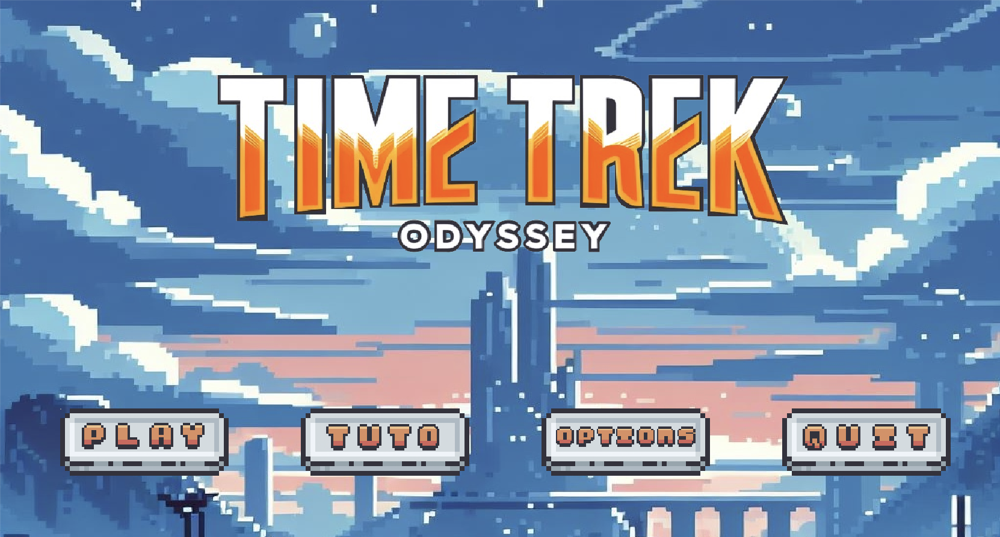 | 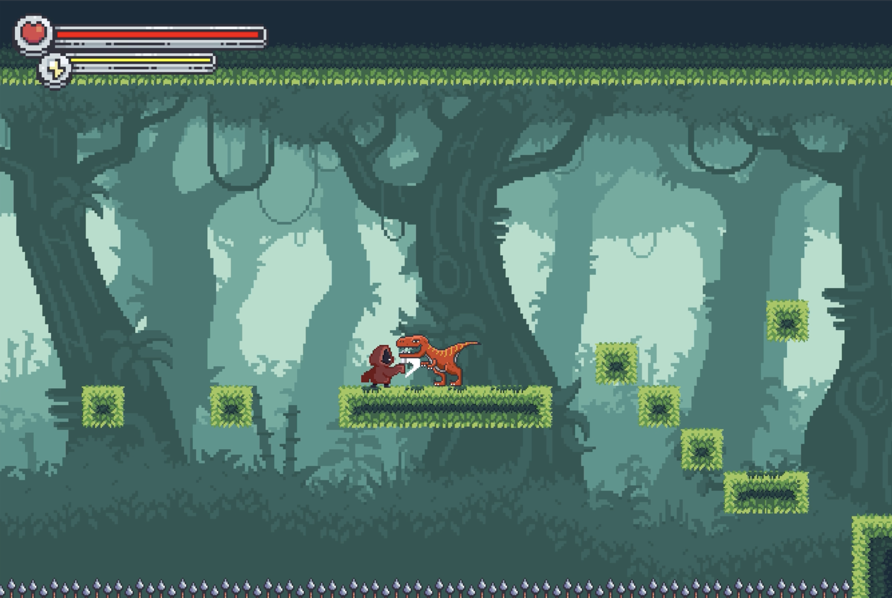 | 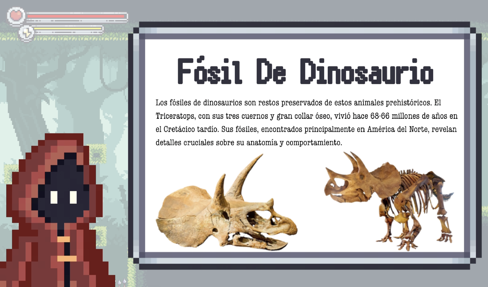 |

<!-- Opcional: un GIF corto del juego llama mucho la atención en GitHub -->
<!-- <p align="center"></p> -->

---

## Niveles y objetos especiales

Cada nivel está inspirado en una era distinta de la historia, con su propio fondo, enemigo, música y objetos históricos que el jugador debe recolectar.


### Nivel 1 — Período Jurásico
**Enemigo:** Dinosaurio — listo para atacar si te cruzas en su camino.

| Fósiles | Huellas | Huevos |
|:---:|:---:|:---:|
| 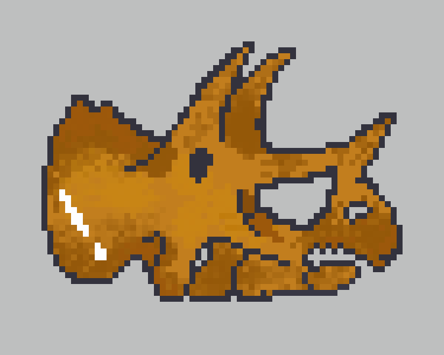 | 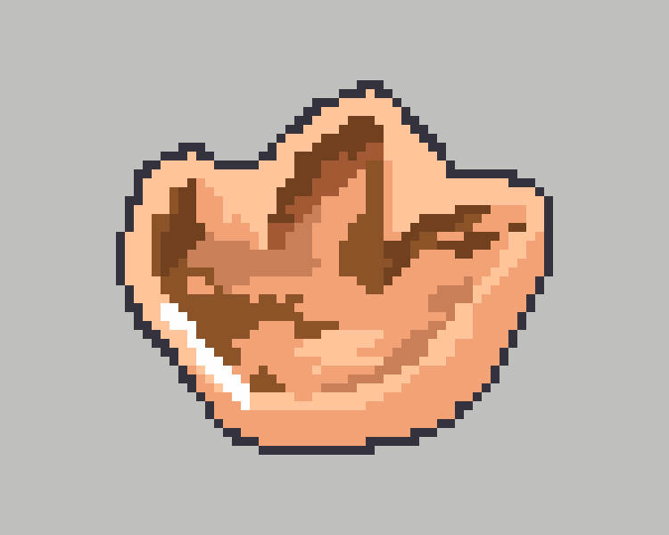 | 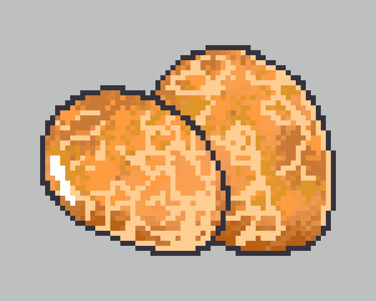 |

### Nivel 2 — Prehistoria
**Enemigo:** Tigre dientes de sable.

| Cuchillos de piedra | La rueda | Pinturas rupestres |
|:---:|:---:|:---:|
| 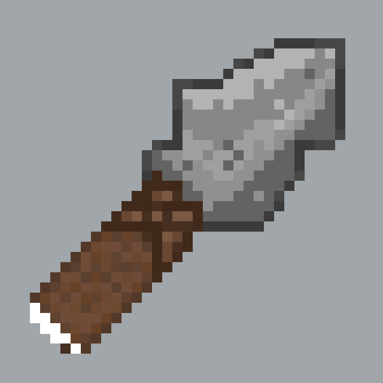 | 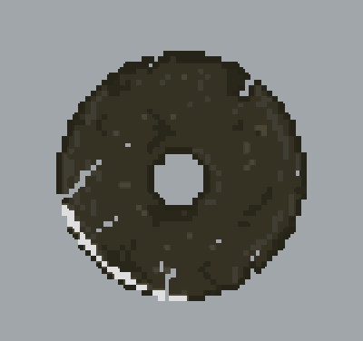 | 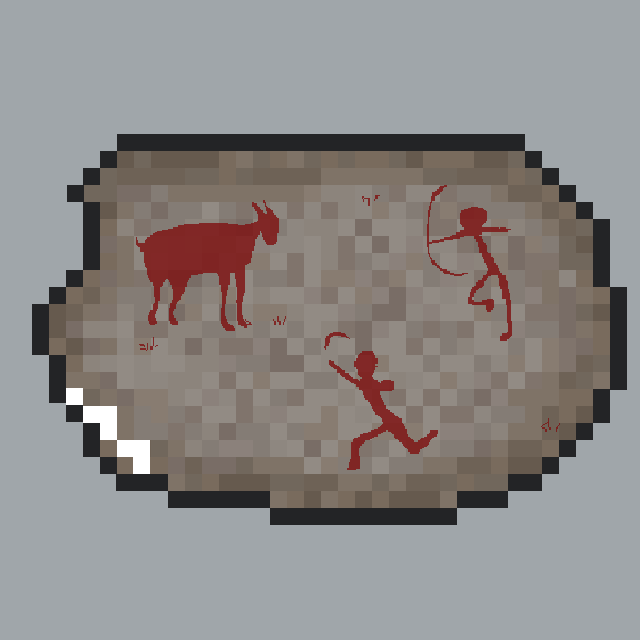 |

### Nivel 3 — Antigüedad
**Enemigo:** Soldado — no te dejará acercarte a los dioses.

| Esculturas | Monedas | Civilización (torre) |
|:---:|:---:|:---:|
| 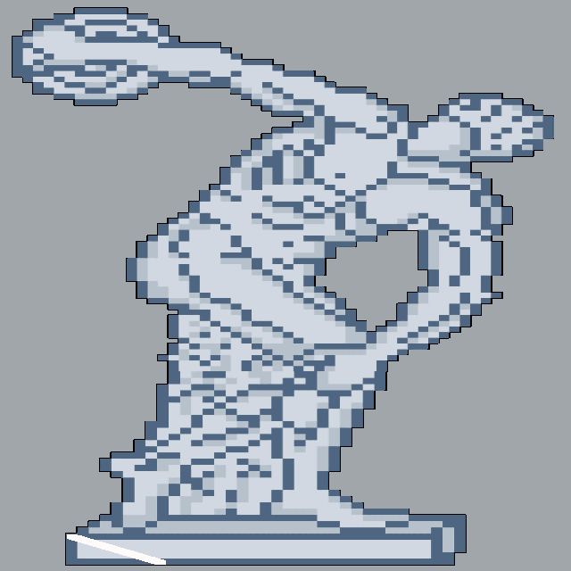 | 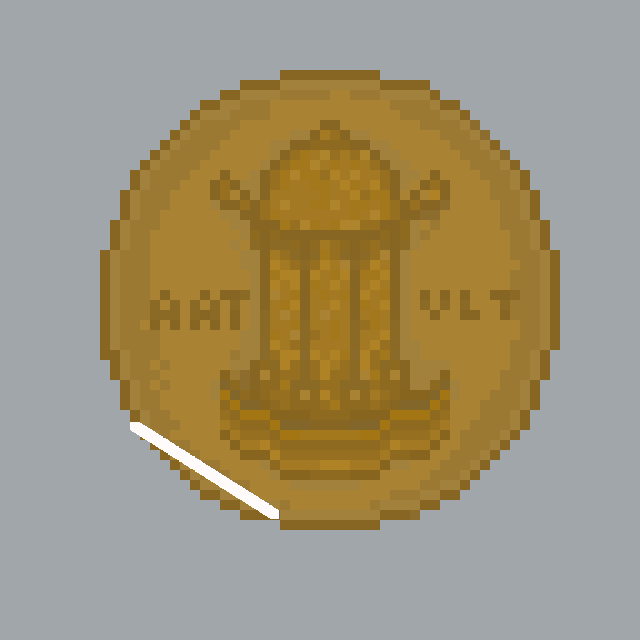 | 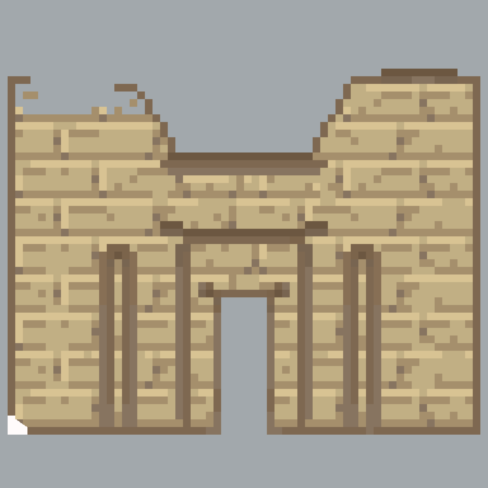 |

### Nivel 4 — Edad Media
**Enemigo:** El Rey — listo para defender su reino.

| Universidades | Conquista (barco) | Molinos |
|:---:|:---:|:---:|
| 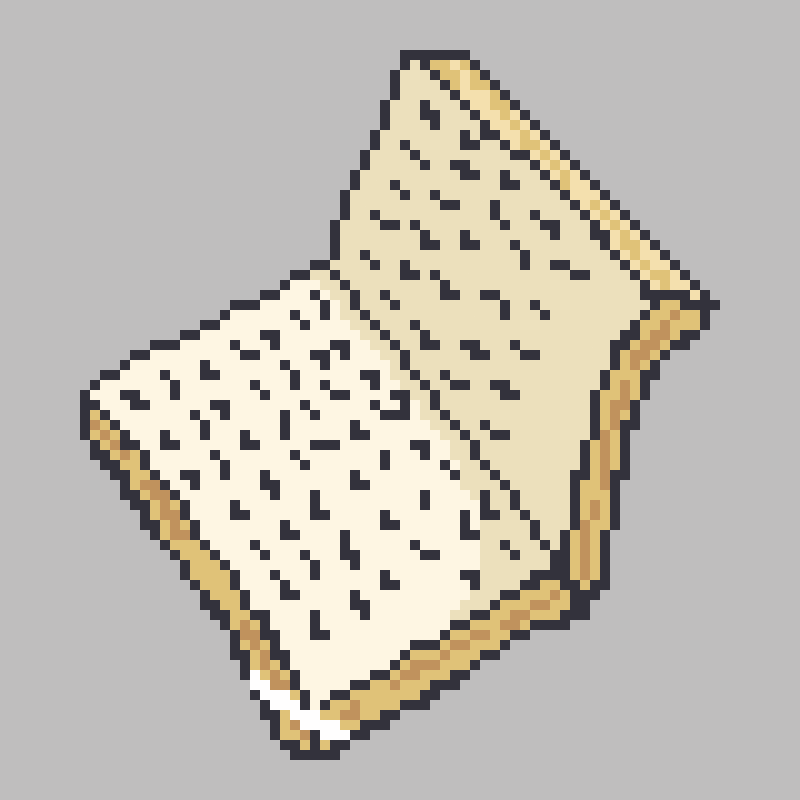 | 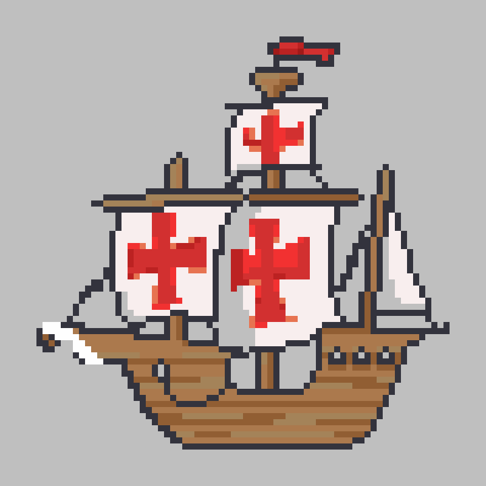 | 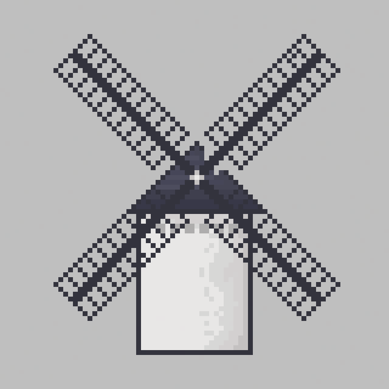 |

### Nivel 5 — Edad Contemporánea
**Enemigo:** Guerrero — dispara apenas te ve.

| Wi-Fi | Bomba | Penicilina |
|:---:|:---:|:---:|
| 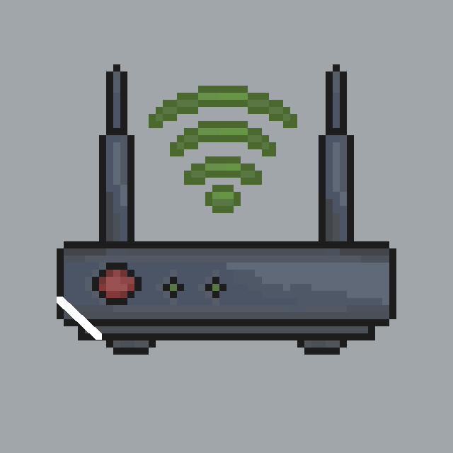 | 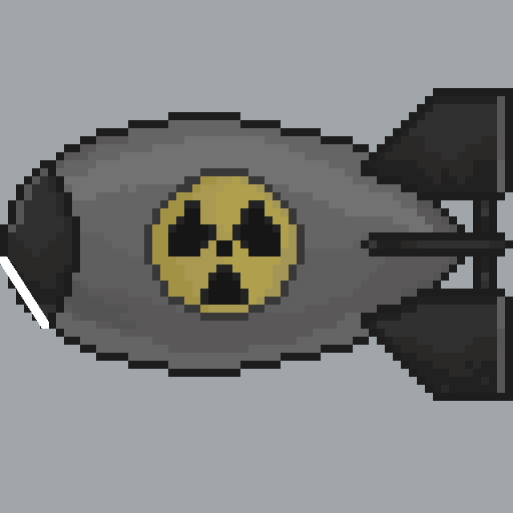 |  |

### Piezas de la máquina del tiempo

<p align="center">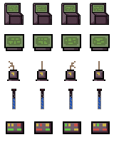</p>

---

## Mecánicas de juego

- Plataformas y colisiones basadas en un mapa de *tiles* de 32×32 px (ventana de 26×14 tiles).
- Combate cuerpo a cuerpo con ataque normal y un ataque de poder que consume la barra de energía.
- Barra de vida y energía del jugador, incluye pociones para recuperarlas.
- Trampas (pinchos) y cañones como obstáculos del escenario.
- Recolección de objetos históricos con narración en audio de cada uno.
- Menú, tutorial, pausa, opciones de audio (música y efectos con control de volumen) y pantallas de *Game Over* y *Nivel completado*.
- Música propia para el menú y para cada uno de los niveles.

---

## Controles

| Tecla | Acción |
|:---:|---|
|  | Moverse a la izquierda |
|  | Moverse a la derecha |
|  /  | Saltar |
|  | Atacar |
|  | Ataque de poder |
| `Esc` | Pausar / reanudar |
| `Enter` | Seleccionar en el menú |
| Mouse | Navegar por menús y botones |

---

## Investigación detrás del juego

Time Trek: Odyssey nace de un artículo de investigación que analiza los videojuegos como herramienta para enseñar historia a estudiantes de secundaria. Ante la falta de interés de muchos jóvenes por el pasado, el documento propone combinar entretenimiento y aprendizaje mediante escenarios y objetos históricos interactivos que despiertan la curiosidad y facilitan la comprensión de cada época.

El artículo incluye:

- **Revisión bibliográfica** de propuestas educativas similares basadas en videojuegos.
- **Metodología de desarrollo**, con los requisitos funcionales y no funcionales del juego.
- **Enfoque inclusivo**, con narración por voz para personas con dificultades de lectura o visuales.
- **Pruebas de usabilidad con estudiantes**, cuyos resultados muestran que el juego es fácil de usar, ayuda a retener la información histórica y motiva a aprender.
- **Conclusiones** sobre el impacto del juego en su público objetivo.

<div align="center">

[](https://uninorte-my.sharepoint.com/:b:/g/personal/keslyr_uninorte_edu_co/IQCfni1PV1D9QpK_0MRGfyjUAfmK1oBCkdLuWhzcCOTeF1Q?e=fFW3Su)

</div>

---

## Tecnologías

| Tecnología | Uso |
|---|---|
| **Java 19** | Lenguaje principal del juego |
| **Java AWT / Swing** | Ventana, renderizado 2D (`Graphics`) y eventos de teclado y mouse |
| **javax.sound.sampled** | Reproducción de música y efectos de sonido (`.wav`) |
| **javax.imageio** | Carga de sprites, *atlas* y mapas de niveles (`.png`) |
| **Apache Ant + NetBeans** | Compilación y gestión del proyecto |
| **HTML / CSS / JS ** | [Página web del juego](https://timetrekodyssey.netlify.app) |

---

## Estructuras de datos utilizadas

Entre estas, el juego aplica:

- **Matrices bidimensionales (`int[][]`)**: Representan el mapa de cada nivel. Los niveles se diseñan como imágenes en `res/lvls/`, y el color de cada píxel se traduce a un tipo de *tile*, enemigo u objeto. Se usan para detectar colisiones y suelo (`HelpMethods`).
- **Matrices de sprites (`BufferedImage[][]`)**: Guardan las animaciones de cada entidad por estado (quieto, correr, saltar, atacar, morir…) y por cuadro.
- **Listas dinámicas (`ArrayList`)**: Almacenan los enemigos, pociones, trampas, cañones, proyectiles y objetos históricos de cada nivel, y se recorren en cada ciclo de actualización y dibujo.
- **Máquina de estados (`enum Gamestate`)**: Controla el flujo entre Menú, Tutorial, Opciones y Juego.

---

## Arquitectura del proyecto

```
TimeTrek/
├── src/
│   ├── main/          # Punto de entrada, ventana, panel y game loop (120 FPS / 200 UPS)
│   ├── gamestates/    # Estados: Menu, Tutorial, Playing, GameOptions
│   ├── entities/      # Player, Enemy y enemigos por era (Dino, DienteDeSable, Soldier, Rey, FinalEnemy)
│   ├── objects/       # Objetos históricos por era, pociones, trampas y ObjectManager
│   ├── levels/        # Level y LevelManager (carga de niveles desde imágenes)
│   ├── ui/            # Overlays (pausa, game over, nivel completado) y botones
│   ├── audio/         # AudioPlayer: música y efectos
│   ├── inputs/        # Teclado y mouse
│   └── utilz/         # Constantes, colisiones (HelpMethods) y carga de recursos (LoadSave)
├── res/               # Sprites, fondos, mapas de niveles (lvls/) y audio
├── docs/img/          # Imágenes del README
├── nbproject/         # Configuración de NetBeans
└── build.xml          # Script de compilación Ant
```

---

## Instalación y ejecución

### Requisitos
- **JDK 19** o superior
- (Opcional) **Apache NetBeans** o **Apache Ant**

### Opción 1 — NetBeans
1. Clona el repositorio:
   ```bash
   git clone https://github.com/USUARIO/TimeTrek.git
   ```
2. En NetBeans: **File → Open Project** y selecciona la carpeta `TimeTrek`.
3. Ejecuta con **Run Project** (`F6`).

### Opción 2 — Ant
```bash
ant jar
java -jar dist/TimeTrek.jar
```

### Opción 3 — Línea de comandos (sin IDE)
```bash
mkdir -p out
javac -d out $(find src -name "*.java")
cp -r res/* out/
java -cp out main.MainClass
```

---

## Equipo

| Integrante | Rol |
|---|---|
| **Joshua Lobo** | Project Manager |
| **Kesly Rodríguez** | Directora de Documentación |
| **Laura González** | Directora de UI/UX |
| **Santiago Vengoechea** | Director de Pruebas y Sonido |
| **Diana García** | Directora de Diseño |

